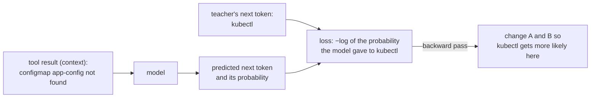
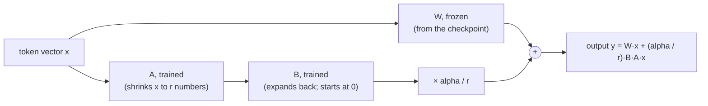
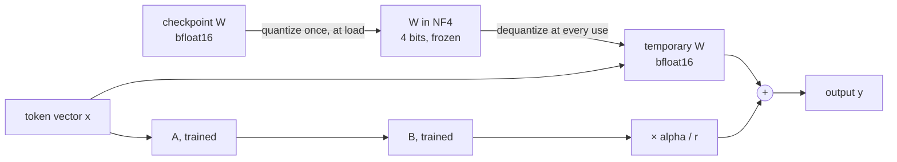

# Fine-tuning concepts

This page explains the terms that the [proof of concept](README.md) and the
fine-tuning protocol (#24) use: how an agent attempt becomes a training
example, what the model is made of, what training changes and what fills the
GPU memory. Each section ends with what this project does. Values marked
_POC_ are the ones the proof of concept used to compare GPUs; the values for
the real training runs (#26) are set in #24 and the
[decision log](../../decision-log.md).

## From an attempt to a training example

**Trajectory.** The full record of one benchmark attempt: system prompt,
tool definitions, task, the model's reasoning, its tool calls, the tool
results and its final report. Successful trajectories of a teacher model are
the training examples (D-054). One trajectory is one example; it is never
split.

**Token.** The unit a language model reads and writes: a word, part of a
word or a special marker. A tokenizer turns text into token IDs from a fixed
vocabulary (248,320 tokens for Qwen3.5, 262,144 for Gemma 4). Trajectory
length, memory and cost are all counted in tokens; the POC trajectories had
4,200 to 16,200 tokens.

**Chat template.** The model's own text format for a conversation, with
special markers for each turn (`<|im_start|>assistant` for Qwen3.5,
`<|turn>model` for Gemma 4). The trajectory is rendered with the same
template the served model uses, so the model trains on exactly the text it
later sees and writes.

**Target tokens (loss mask).** Training only counts the tokens the model
itself writes when it is served: its reasoning, tool calls and final report.
The system prompt, task and tool results are context: the model reads them
but is not trained to produce them. In the POC 27–55% of a trajectory's tokens
were targets.

**Sequence-length cap.** The longest trajectory trained on. A longer one is
dropped, never cut, because a cut trajectory would teach an attempt without
its end. _POC: 16,384 tokens._

## What the model is made of

A language model is a stack of **layers** (32 in Qwen3.5 4B and 9B,
42 in Gemma 4 E4B). Each token is a vector of numbers (the **hidden state**,
2,560 numbers wide in Qwen3.5 4B, 4,096 in 9B). Each layer updates every
token's vector in two steps: a mixing step that lets the token look at
earlier tokens (attention), and a per-token step (the MLP). After the last
layer, the **output head** turns each vector into a score for every
vocabulary token (the **logits**), and the highest scores are the likely next
tokens.

**Weights and projections.** Almost all of a model's weights are in
**projections**: matrices that multiply a token's vector into another
vector. Each kind of layer has its own projections with their own names;
LoRA adapts projections by name (see [Projections by name](#projections-by-name)).

**Attention.** For each token, the query is compared with the keys of all
earlier tokens; the comparison gives weights, and the token takes the
weighted sum of their values ([Vaswani et al.,
2017](https://arxiv.org/abs/1706.03762)). This is how the model connects an
error in a tool result to the command it ran ten turns earlier. Its cost
grows with the square of the sequence length, which is why long trajectories
are expensive. Qwen3.5 uses **grouped-query attention**: 16 query heads
share 4 key/value heads, which saves memory.

**Sliding-window attention (Gemma 4).** Gemma 4 E4B has 35 layers that only look
at the last 512 tokens and 7 **global** layers (every sixth, including the
last) that look at the whole sequence. This keeps long sequences cheap while the global layers
still connect distant parts.

**Linear attention (Qwen3.5).** Three of every four Qwen3.5 layers use
**Gated DeltaNet** instead of attention ([Yang et al.,
2024](https://arxiv.org/abs/2412.06464)): the layer keeps a fixed-size
memory that each token updates, so the cost grows only linearly with the
length. Every fourth layer is ordinary (gated) attention. The kernels for
these layers come from `flash-linear-attention`.

**Short convolution (`causal-conv1d`).** Inside each Gated DeltaNet layer,
the query, key and value vectors are first mixed with those of the previous
3 tokens (a convolution of width 4). `causal-conv1d` is the fast GPU kernel
for this step; without it, transformers uses a slower PyTorch version. The
POC measured 10–14% faster Qwen training with the kernel.

**Per-layer embeddings (Gemma 4 E2B and E4B).** Each layer also has its own
small embedding per token. These tables are large (Gemma 4 E4B has 8B
weights in total, 4.5B "effective") but are only looked up, not multiplied,
so they cost memory but little compute.

### Projections by name

The mixing step and the MLP are built from projections. Their names come
from the model code in transformers, and LoRA picks projections by these
names.

**Attention** (Gemma 4, every layer; Qwen3.5, every fourth layer):

| Name     | What it makes         | What it is for                                            |
| -------- | --------------------- | --------------------------------------------------------- |
| `q_proj` | the token's **query** | what this token is looking for in earlier tokens          |
| `k_proj` | the token's **key**   | what this token offers, matched against later queries     |
| `v_proj` | the token's **value** | the information it passes on when a query matches its key |
| `o_proj` | the layer's output    | combines the heads' results back into the token's vector  |

Attention compares each query with every earlier key, turns the scores into
weights and adds up the matching values. Each layer has several **heads**,
each with its own slice of q, k and v, so one head can follow tool names
while another follows error messages.

How the two families differ:

- **Qwen3.5 (gated attention):** `q_proj` makes the query and a **gate**
  together (twice the width); the gate scales the attention result per head
  before `o_proj`, so a head can switch itself off for a token.
- **Gemma 4 (shared keys and values):** the last 18 of Gemma 4 E4B's 42
  layers reuse the keys and values of earlier layers and have no `k_proj` or
  `v_proj`. That is why its adapter covers 258 projections, not 42 × 7 = 294.

**Gated DeltaNet** (Qwen3.5, three of every four layers): instead of
comparing with every earlier token, the layer keeps a memory matrix per
head. Each token reads from it with its query and writes its value into it
under its key.

| Name          | What it makes                                  | What it is for                                                                                 |
| ------------- | ---------------------------------------------- | ---------------------------------------------------------------------------------------------- |
| `in_proj_qkv` | query, key and value together                  | the same roles as in attention; then mixed with the previous 3 tokens by the short convolution |
| `in_proj_z`   | the output **gate**                            | how much of the read result passes on, per channel                                             |
| `in_proj_b`   | the write strength (beta), one number per head | how strongly this token overwrites the memory                                                  |
| `in_proj_a`   | the decay, one number per head                 | how fast the memory forgets older tokens                                                       |
| `out_proj`    | the layer's output                             | the counterpart of `o_proj`                                                                    |

The "delta" rule: a token first reads what the memory currently stores under
its key, and writes only the difference to its own value, scaled by beta.
The decay lets old content fade. The memory has a fixed size, so the cost
per token does not grow with the length, but it can only hold a compressed
summary; that is why every fourth layer is full attention.

**MLP** (every layer of both families):

| Name        | What it makes                                                       | What it is for                                       |
| ----------- | ------------------------------------------------------------------- | ---------------------------------------------------- |
| `gate_proj` | the gate, through an activation function                            | which features to let through                        |
| `up_proj`   | a wider vector (9,216 numbers in Qwen3.5 4B, 10,240 in Gemma 4 E4B) | the candidate features                               |
| `down_proj` | the token's vector again                                            | combines the passed features back to the hidden size |

The MLP computes `down_proj(act(gate_proj(x)) × up_proj(x))` for each token
alone; its three projections hold most of each layer's weights (about 70
million of Qwen3.5 4B's roughly 113 million per linear-attention layer).

## Training

**Loss (cross-entropy).** For each target token, the model predicts the next
token; the loss is the negative log of the probability it gave the right
one, averaged over the target tokens. 0 is a perfect prediction; higher is
worse. **Training loss** is measured on the examples being trained on;
**evaluation loss** on held-back examples, before and after training, to see
whether the model learned something general rather than memorising.

**Perplexity.** The exponential of the loss: roughly, how many tokens the
model was choosing between on average. The POC measured it on the
**served** model (llama.cpp, 4-bit GGUF, with and without the adapter) to
check that what was learned on the training checkpoint carries over to the
model the benchmark runs.

**Gradient and backpropagation.** After the forward pass computes the loss,
the backward pass computes, for every trainable weight, which direction of
change would lower the loss (the gradient).

**Optimizer (AdamW).** The rule that turns gradients into weight changes.
AdamW keeps two running averages per trainable weight (of the gradient and of
its square) and scales each change by them, so every weight moves at a
sensible speed ([Loshchilov and Hutter,
2017](https://arxiv.org/abs/1711.05101)). _POC: AdamW, no weight decay._

**Learning rate.** The size of each weight change. Too high and training
becomes unstable or overwrites what the model knew; too low and the model
learns little. _POC: 1e-4._

**Warm-up and schedule.** The learning rate starts small and rises to its
full value over the first steps (warm-up), because the first gradients of a
fresh adapter are noisy. A schedule can then keep it constant or lower it
towards the end (for example along a cosine curve) so the last steps make
fine adjustments. _POC: linear warm-up over 3 steps, then constant._

**Step, batch and epoch.** A step is one weight update. The batch is how many
examples one step uses; here one trajectory per step, because trajectories
differ a lot in length. An epoch is one pass over all training examples, so
with one example per step the number of steps is epochs times examples. The
protocol's configurations use 3 epochs (C1, C2) or 1 epoch (C3) (#24).

**Seed.** The number that fixes the random choices: the order of the examples
and the starting values of the adapter. The same seed with the same data and
code repeats the same run. _POC: 0._

## How the model learns from a trajectory

A language model does one thing: given the tokens so far, it gives a
probability to every possible next token. Fine-tuning on a trajectory uses
exactly that.

1. **The whole trajectory goes in at once.** The rendered trajectory, up to
   16K tokens, is one input. Attention is causal: each position sees only
   the tokens before it, so one forward pass computes the model's prediction
   for every position in parallel, as if it were generating the trajectory
   token by token.
2. **Each target position is a question with a known answer.** At every
   target token, the model's prediction is compared with the token the
   teacher actually wrote. The loss is low when the model already gave that
   token a high probability, high when it did not.
3. **Context is read, not scored.** The system prompt, task and tool results
   shape every prediction that follows them, but the model is not trained to
   produce them: it never has to predict what the cluster will answer, only
   what to write after it.
4. **The gradient says how to make the teacher's tokens more likely.** The
   backward pass finds how A and B in each adapted projection should change
   so that, next time, the same context gives the teacher's next token a
   higher probability.
5. **Patterns repeat across trajectories.** One trajectory alone would teach
   only to copy it. Over many trajectories on different scenarios the
   changes that help everywhere add up: the tool-call format, which command
   follows which kind of error, checking the result after a fix, ending with
   a report instead of continuing. Changes that fit only one scenario point in
   different directions and largely cancel out. The evaluation loss on
   held-back trajectories shows whether what was learned is general.

An illustrative piece of a trajectory, split into context and targets:

| Part        | Text                                                                         | Trained on   |
| ----------- | ---------------------------------------------------------------------------- | ------------ |
| tool result | `Error from server (NotFound): configmaps "app-config" not found`            | no (context) |
| reasoning   | `The deployment expects a ConfigMap that does not exist. Check what exists.` | yes          |
| tool call   | `kubectl get configmaps -n shop`                                             | yes          |
| tool result | `NAME  DATA  AGE / app-cfg  2  5m`                                           | no (context) |
| reasoning   | `The ConfigMap is named app-cfg; the deployment refers to the wrong name.`   | yes          |

Each "yes" row is many next-token predictions: after `kubectl`, the model is
asked for `get`, after `get` for `configmaps`, and so on, each with
everything before it as context. This is called **teacher forcing**: the
model always continues from the teacher's text, never from its own mistakes,
so one forward pass trains every position.

What it does not learn: anything the trajectories do not show. The adapter
makes the teacher's behaviour on these scenarios more likely; it does not
add knowledge of Kubernetes that no trajectory contains, and a trajectory
with a bad step teaches the bad step too, which is why only clean, fully
successful attempts are used (D-054).

## LoRA

**LoRA (low-rank adaptation).** Instead of changing a projection's weight
matrix W, LoRA freezes it and trains two small matrices next to it, A and B
([Hu et al., 2021](https://arxiv.org/abs/2106.09685)). The trained A and B of
all adapted projections are the **adapter**: a separate file (85 MB for
Qwen3.5 4B, 140 MB for Gemma 4 E4B in the POC), applied to the unchanged base
model. The benchmark serves it with llama.cpp next to the unchanged served
GGUF (#24).

How it works, step by step:

1. **Load and freeze.** The checkpoint is loaded and all its weights are
   frozen: training never changes them.
2. **Attach the adapter.** Each target projection W (size d_out × d_in) gets
   A (r × d_in, small random values) and B (d_out × r, zeros). Because B is
   zero, the model's output is unchanged at the start.
3. **Forward pass.** Each adapted projection computes its usual W·x and adds
   the adapter's correction (alpha / r)·B·(A·x). A first shrinks the token's
   vector to r numbers, B turns them back into a full-size change.
4. **Loss.** The loss is computed on the target tokens of the trajectory.
5. **Backward pass.** Gradients flow back through the whole model, but only
   A and B receive them; W stays as it was.
6. **Update.** AdamW changes A and B. Steps 3–6 repeat for every training
   step.
7. **Save.** Only A and B are saved: the adapter.
8. **Serve.** llama.cpp loads the served GGUF and the adapter (converted to
   GGUF) and adds the same correction at each adapted projection. The base
   file is not changed or merged with the adapter.

Why it is small: for one MLP projection of Qwen3.5 4B (`down_proj`, 9,216 →
2,560), W has 23.6 million weights; with rank 16, A and B together have
188,416, about 0.8%. The change B·A can only point in r directions, which is
usually enough to teach a model a task format or style without overwriting
what it knows.

**Rank (r).** The inner size of A and B: how many independent directions of
change each projection can learn. A higher rank can learn more but trains
more weights. With rank 16 the Qwen3.5 4B adapter has 21.2 million trainable
weights and the Gemma 4 E4B adapter 34.9 million, under 1% of the model. The
protocol compares rank 16 (C1, C3) and rank 8 (C2) (#24).

**Alpha.** A scale for the adapter's change: the update is multiplied by
alpha / r. With alpha equal to the rank the factor is 1; changing the rank
without changing alpha also changes how strongly the adapter acts, so the
comparison of ranks keeps alpha / r fixed or states that it does not.
_POC: alpha 16 with rank 16._

**Dropout.** During training, a random fraction of the adapter's inputs is
set to zero at each step, so the adapter cannot rely on single inputs; this
can reduce memorising on small datasets. _POC: 0._

**Target modules.** The projections that get an adapter: in the language
model only, because the served GGUF has no vision or audio parts. _POC: the
seven attention and MLP names (`q_proj`, `k_proj`, `v_proj`, `o_proj`,
`gate_proj`, `up_proj`, `down_proj`)._ In Qwen3.5 the attention names exist
only in the 8 full-attention layers, so the POC's Qwen3.5 4B adapter covered
128 projections and left the mixing step of the 24 Gated DeltaNet layers
without one. From #26 on, `in_proj_qkv` and `in_proj_z` are adapted too;
`out_proj` is not, because the pinned llama.cpp cannot convert a LoRA on it
(see the [check](README.md#adapter-on-qwen35s-linear-attention-layers)).

## QLoRA

**QLoRA (quantized LoRA).** The same adapter as LoRA, but the frozen base
weights are stored in 4 bits instead of 16 ([Dettmers et al.,
2023](https://arxiv.org/abs/2305.14314)). Only the storage of W changes; A,
B and the training steps are the same.

How it differs, step by step:

1. **Quantize at load.** Each frozen W is converted to **NF4**: weights are
   grouped in blocks of 64, each block keeps one scale, and each weight is
   one of 16 levels spaced for normally distributed values. **Double
   quantization** stores the block scales in 8 bits too. The output head and
   the vision and audio parts stay in 16 bits.
2. **Attach the adapter.** A and B in bfloat16, exactly as in LoRA.
3. **Forward and backward pass.** At every use, the 4-bit W is expanded back
   to a temporary bfloat16 matrix for the multiplication, then discarded.
4. **Update and save.** As in LoRA; the adapter is a normal LoRA adapter.

|                                 | LoRA                         | QLoRA                                                   |
| ------------------------------- | ---------------------------- | ------------------------------------------------------- |
| Frozen weights                  | bfloat16, 2 bytes each       | NF4, about 0.5 byte each                                |
| Weight memory, Qwen3.5 4B       | 7.9 GiB                      | about a quarter                                         |
| Speed                           | faster                       | slower: W is dequantized at every use                   |
| What the adapter learns against | the checkpoint's own weights | rounded weights, slightly different from the checkpoint |

Neither matches the served model exactly: the benchmark serves a GGUF with
its own 4-bit quantization (#24), and the adapter is applied to it either
way. The code supports both; #24 sets the precision of the training runs.

## Number formats and memory

**float32, bfloat16.** A weight stored in 32 bits (float32) or 16 bits
(bfloat16). bfloat16 keeps float32's range with less precision and halves
the memory, so a 4B model needs about 8 GB of GPU memory for its weights.
Training runs in bfloat16 (D-055).

**Quantization.** Storing weights in fewer bits to save memory. Training
uses it only in QLoRA (see [QLoRA](#qlora)). The served model is quantized
separately (GGUF, about 4 bits) for llama.cpp.

**Where the GPU memory goes.** Four parts:

1. **Weights**: fixed per model (7.9 GiB for Qwen3.5 4B, 14.9 GiB for Gemma 4
   E4B in bfloat16).
2. **Activations**: the intermediate values of the forward pass that the
   backward pass needs; they grow with the sequence length. In the POC, Qwen3.5
   4B grew from 9.9 GiB at 4K tokens to 15.2 GiB at 16K.
3. **Gradients and optimizer state**: only for trainable weights, so small
   with LoRA.
4. **Logits**: one score per vocabulary token per position; for 16K tokens of
   Gemma 4 in float32 that would be about 16 GiB on its own.

**Gradient checkpointing.** Only each layer's input is kept from the forward
pass; the rest is recomputed during the backward pass ([Chen et al.,
2016](https://arxiv.org/abs/1604.06174)). It costs about one extra forward
pass and saves most of the activation memory; it is what makes 16K-token
trajectories fit.

**Chunked loss.** The loss is computed from the last hidden states 256
target positions at a time, each chunk recomputed in the backward pass, so
the full logits matrix is never in memory.

**Memory sweep.** Before training, each run trains one step at 4K, 8K, 12K
and 16K tokens and records peak memory and speed, or that it ran out of
memory. It shows whether the cap fits the GPU before the real steps start.

## Hardware and cost

**GPU memory (VRAM).** The memory on the GPU, where weights, activations and
the adapter must fit (40 GB on the A100 40 GB, 48 GB on the L40S). The
**host** is the machine around the GPU (CPU and RAM), which only loads data
and the checkpoint.

**Throughput and cost per token.** Training tokens per second, and from it
the cost per million training tokens: the GPU's price per hour divided by the
tokens it trains per hour. The POC chose the GPU by this cost.
